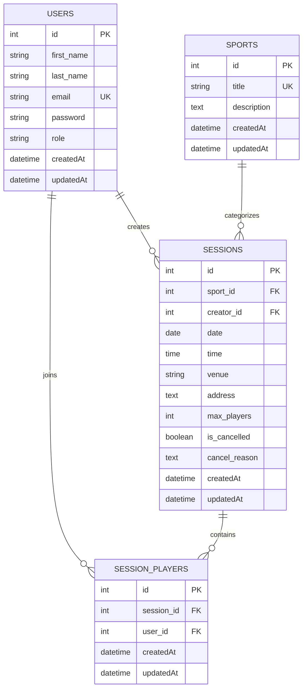

# 🏆 Sports Scheduler

A modern full-stack web application that helps sports enthusiasts and facility coordinators organize, discover, host, and join sporting sessions.

The application provides user authentication, role-based access control, sports management, session scheduling, player registration, session cancellation, dashboards, and reports.

Built using **Node.js, Express 5, PostgreSQL, Sequelize ORM, EJS, Passport.js, and bcrypt**.

---

## 📑 Table of Contents

- [📖 Project Overview](#-project-overview)
- [✨ Features](#-features)
  - [🏅 Player Features](#-player-features)
  - [🛡️ Admin Features](#-admin-features)
  - [🔐 Authentication and Security](#-authentication-and-security)
- [📸 Application Interface](#-application-interface)
- [🛠️ Technology Stack](#-technology-stack)
- [📂 Project Structure](#-project-structure)
- [⚙️ Prerequisites](#-prerequisites)
- [🚀 Installation and Local Setup](#-installation-and-local-setup)
- [🔑 Environment Variables](#-environment-variables)
- [🗄️ Database](#️-database)
- [📜 NPM Scripts](#-npm-scripts)
- [🧪 Testing](#-testing)
- [☁️ Deployment on Render](#️-deployment-on-render)
- [❤️ Health Check](#️-health-check)
- [📊 Database Schema](#-database-schema)
- [🔒 Security](#-security)
- [🤝 Contributing](#-contributing)
- [📄 License](#-license)

---

## 📖 Project Overview

**Sports Scheduler** is a web-based sports session management platform.

The application allows players to discover available sports sessions, join games, host their own sessions, and manage their participation.

Administrators can manage the sports catalog, monitor sessions, and view reports and analytics.

The project uses **PostgreSQL** as the database and **Sequelize** as the Object-Relational Mapping (ORM) layer. Authentication is implemented using **Passport.js**, **express-session**, **connect-pg-simple**, and **bcrypt**.

---

## ✨ Features

### 🏅 Player Features

- 🔎 Browse available sports sessions
- 🎯 Filter sessions based on sport, venue, or status
- 🏟️ Host a new sports session
- 📅 Select session date and time
- 📍 Specify venue and address
- 👥 Set maximum player capacity
- ➕ Join available sessions
- ➖ Leave joined sessions
- ❌ Cancel hosted sessions
- 📝 Provide cancellation reasons
- 📊 View personal session activity
- 👤 Manage player participation

### 🛡️ Admin Features

- 🏅 Manage the sports catalog
- ➕ Add sports
- ✏️ Update sports
- 👁️ View sports
- 🗑️ Retire sports when required
- 📊 View reports and participation statistics
- 📈 Monitor session activity
- 🔍 Maintain administrative oversight of the platform

### 🔐 Authentication and Security

- 🔑 User registration and login
- 🔒 Password hashing using bcrypt
- 🛂 Passport.js Local Strategy
- 👥 Role-Based Access Control (RBAC)
- 👤 Player and Admin roles
- 🍪 Session-based authentication
- 🗄️ PostgreSQL-backed session storage using `connect-pg-simple`
- 💬 Flash messages for errors and successful operations
- 🔐 Secure production session cookies

---

## 📸 Application Interface

> The screenshots below are stored inside the `screenshots/` folder of this repository.

### 🏠 Browse Sports Sessions


### 📝 Create Account


### 🏟️ Host a Sports Session


### 📋 Session Details & Player Roster


### 🛡️ Sports Management


> To add more screenshots, place the image inside the `screenshots/` folder and reference it using the same Markdown format.

---

## 🛠️ Technology Stack

| Category | Technology |
|---|---|
| **Runtime** | Node.js |
| **Backend Framework** | Express 5 |
| **Database** | PostgreSQL |
| **ORM** | Sequelize 6 |
| **Template Engine** | EJS |
| **Authentication** | Passport.js |
| **Password Security** | bcrypt |
| **Session Management** | express-session |
| **Session Store** | connect-pg-simple |
| **Flash Messages** | connect-flash |
| **Testing** | Jest |
| **HTTP Testing** | Supertest |
| **Deployment** | Render |
| **Version Control** | Git & GitHub |
| **Frontend Styling** | HTML, CSS, Vanilla JavaScript |

---

## 📂 Project Structure

```text
Sports/
│
├── __tests__/
│   ├── auth.test.js
│   ├── rbac.test.js
│   ├── sessions.test.js
│   └── setup.js
│
├── config/
│   ├── config.js
│   ├── passport.js
│   └── seedData.js
│
├── middleware/
│   └── auth.js
│
├── migrations/
│   ├── database migration files
│   └── ...
│
├── models/
│   ├── index.js
│   ├── user.js
│   ├── sport.js
│   ├── session.js
│   └── sessionplayer.js
│
├── public/
│   ├── css/
│   ├── js/
│   └── images/
│
├── routes/
│   ├── index.js
│   ├── auth.js
│   ├── sports.js
│   ├── sessions.js
│   └── reports.js
│
├── views/
│   ├── admin/
│   ├── auth/
│   ├── layouts/
│   └── player/
│
├── screenshots/
│   ├── browse-sessions.png
│   ├── signup.png
│   ├── host-session.png
│   ├── session-details.png
│   └── sports-management.png
│
├── .env.example
├── app.js
├── package.json
└── render.yaml
```

The application entry point is `app.js`, while Sequelize database initialization is handled through the `models` and `config` directories. :contentReference[oaicite:2]{index=2}

---

## ⚙️ Prerequisites

Before running the application locally, install:

- **Node.js**
- **PostgreSQL**
- **Git**
- **npm**

Recommended environment:

```text
Node.js 18+
PostgreSQL 14+
```

---

## 🚀 Installation and Local Setup

### 1. Clone the Repository

```bash
git clone https://github.com/pillirenukadevi/sports-scheduler.git
```

Move into the project:

```bash
cd sports-scheduler
```

---

### 2. Install Dependencies

```bash
npm install
```

---

### 3. Configure Environment Variables

Create a `.env` file using `.env.example`.

```bash
cp .env.example .env
```

For Windows, you can also create the `.env` file manually.

Example local configuration:

```env
PORT=3000
NODE_ENV=development

SESSION_SECRET=your_long_random_session_secret

DB_USER=postgres
DB_PASSWORD=your_local_postgresql_password
DB_NAME=sports_scheduler_dev
DB_TEST_NAME=sports_scheduler_test
DB_HOST=127.0.0.1
DB_PORT=5432
```

> ⚠️ Never upload your real `.env` file, database password, session secret, or other credentials to GitHub.

---

### 4. Create PostgreSQL Databases

Open PostgreSQL/pgAdmin/psql and create:

```sql
CREATE DATABASE sports_scheduler_dev;
```

For testing:

```sql
CREATE DATABASE sports_scheduler_test;
```

---

### 5. Run Database Migrations

Run:

```bash
npm run db:migrate
```

This creates the required database tables using Sequelize migrations.

---

### 6. Start the Application

For development:

```bash
npm run dev
```

For normal/production-style startup:

```bash
npm start
```

The application runs locally at:

```text
http://localhost:3000
```

---

## 🔑 Environment Variables

### Local Development

| Variable | Purpose |
|---|---|
| `PORT` | Local application port |
| `NODE_ENV` | Application environment |
| `SESSION_SECRET` | Secret used for session cookies |
| `DB_USER` | Local PostgreSQL username |
| `DB_PASSWORD` | Local PostgreSQL password |
| `DB_NAME` | Local development database |
| `DB_TEST_NAME` | Testing database |
| `DB_HOST` | PostgreSQL host |
| `DB_PORT` | PostgreSQL port |

### Production on Render

The important production variables are:

```text
DATABASE_URL
SESSION_SECRET
NODE_ENV
```

Example:

```env
DATABASE_URL=<your-render-postgresql-connection-string>
SESSION_SECRET=<your-random-session-secret>
NODE_ENV=production
```

> Never place real production credentials in this README.

Render supplies the `PORT` variable to the running Web Service automatically. :contentReference[oaicite:3]{index=3}

---

## 🗄️ Database

The project uses:

- **PostgreSQL** for persistent data storage
- **Sequelize ORM** for database interaction
- **Sequelize CLI** for migrations
- **connect-pg-simple** for persistent user sessions

### Main entities

The application contains these primary entities:

```text
Users
Sports
Sessions
Session Players
```

Relationships:

```text
User
 ├── creates Sessions
 └── joins Sessions

Sport
 └── contains Sessions

Session
 └── contains Session Players

Session Player
 ├── references User
 └── references Session
```

---

## 📜 NPM Scripts

| Command | Description |
|---|---|
| `npm run dev` | Starts the development server using nodemon |
| `npm start` | Starts the application using `node app.js` |
| `npm run build` | Runs the configured database migration build step |
| `npm test` | Runs the Jest and Supertest test suite |
| `npm run db:migrate` | Runs pending development migrations |
| `npm run db:migrate:prod` | Runs migrations using the production configuration |
| `npm run db:migrate:undo` | Rolls back the most recent migration |
| `npm run db:seed` | Runs the database seed script when configured |

The production migration script is configured as a Sequelize CLI production migration command. :contentReference[oaicite:4]{index=4}

---

## 🧪 Testing

The project contains automated tests using **Jest** and **Supertest**.

Run all tests with:

```bash
npm test
```

### Test Areas

#### 🔐 Authentication

- User registration
- Duplicate email handling
- Login
- Logout

#### 🛂 Role-Based Access Control

- Player access restrictions
- Admin access restrictions
- Protected routes

#### 🏟️ Sports Sessions

- Session creation
- Joining a session
- Leaving a session
- Capacity restrictions
- Session cancellation

---

## ☁️ Deployment on Render

The application is designed to run as a **Render Node Web Service** backed by a **Render PostgreSQL database**.

### Recommended Web Service Settings

```text
Runtime:
Node

Branch:
main

Build Command:
npm install && npm run build

Start Command:
npm start

Health Check Path:
/health
```

These settings correspond to the Render configuration prepared for the project. :contentReference[oaicite:5]{index=5}

### PostgreSQL

Create a Render PostgreSQL database such as:

```text
sports-scheduler-db
```

Keep the PostgreSQL database and the Web Service in the same Render region.

### Production Environment Variables

Add:

```text
DATABASE_URL
SESSION_SECRET
NODE_ENV
```

Set:

```text
NODE_ENV=production
```

Use the PostgreSQL connection string supplied by the Render database for `DATABASE_URL`.

The Render deployment configuration is prepared to connect the application to the hosted PostgreSQL database through `DATABASE_URL`. :contentReference[oaicite:6]{index=6}

---

## ❤️ Health Check

The application provides:

```text
GET /health
```

The health endpoint checks whether the application can communicate with the PostgreSQL database.

Example successful response:

```json
{
  "status": "ok",
  "uptime": 123,
  "timestamp": "2026-01-01T00:00:00.000Z"
}
```

The endpoint returns a server error status when the database connection is unavailable. :contentReference[oaicite:7]{index=7}

After deployment, test:

```text
https://YOUR-RENDER-SERVICE.onrender.com/health
```

---

## 📊 Database Schema



---

## 🔒 Security

The application follows several security practices:

- Passwords are hashed using bcrypt.
- Authentication uses Passport.js.
- Sessions are stored using PostgreSQL.
- Administrative functionality is protected with role-based authorization.
- Production cookies use secure settings.
- Sensitive configuration is supplied through environment variables.
- `.env` files should not be committed to GitHub.

Production session and proxy configuration are included in the application setup for HTTPS deployment. :contentReference[oaicite:8]{index=8}

---

## 🤝 Contributing

Contributions are welcome.

### 1. Fork the repository

### 2. Create a feature branch

```bash
git checkout -b feature/AmazingFeature
```

### 3. Commit your changes

```bash
git add .
git commit -m "Add AmazingFeature"
```

### 4. Push your branch

```bash
git push origin feature/AmazingFeature
```

### 5. Open a Pull Request

---


GitHub:

https://github.com/pillirenukadevi

---

## ⭐ Project Summary

**Sports Scheduler** is a full-stack sports management application that combines:

```text
User Authentication
        +
Role-Based Access Control
        +
Sports Management
        +
Session Scheduling
        +
Player Registration
        +
PostgreSQL Database
        +
Session Management
        +
Reports & Analytics
        +
Render Deployment
```

The project demonstrates backend development, database management, authentication, authorization, testing, and cloud deployment using a real-world application architecture.
